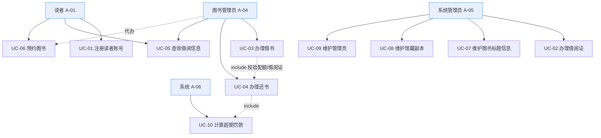

# 03 · 用例规格说明书（Use Case Specification）

> 本文档依据 `02-requirements.md` 编制，描述图书管理系统的参与者与用例。受 `constitution.md` 约束（P-02 起草待审、P-03 UML 文本化、P-07 权限）。
> 用例编号沿用 `00-project-brief.md` §4：UC-01~UC-10；因 `02` 扩充的功能（取消预约、删除借阅证、规则维护等）以"扩展用例"形式列于 §3 并标注来源 FR。

| 项 | 内容 |
|---|---|
| 文档编号 | `specs/03-use-cases.md` |
| 文档类型 | 用例规格（Use Case Spec） |
| 版本 | v1.0（草案） |
| 状态 | ☐ Agent 起草 — 待人工审查（P-02） |
| 上游文档 | `00-project-brief.md`、`01-clarifying-questions.md`、`constitution.md`、`02-requirements.md` |
| 重点用例 | UC-02、UC-03、UC-04、UC-06、UC-10（§4 详细） |

---

## 1. 参与者（Actors）

| 编号 | 参与者 | 类型 | 职责摘要 | 对应需求 |
|---|---|---|---|---|
| A-01 | 读者 Reader（抽象基类） | 人 | 注册、检索、本人查询、预约/取消预约 | FR-001, FR-010, FR-013, FR-014, FR-017, FR-018 |
| A-02 | 学生读者 StudentReader | 人（A-01 子类） | 本科/硕士/博士/专科，受 BR-001/BR-002 约束 | BR-001, BR-002 |
| A-03 | 教师读者 TeacherReader | 人（A-01 子类） | 上限 20、期限 90 天 | BR-001, BR-002 |
| A-04 | 图书管理员 Librarian | 人 | **借书/还书的唯一执行者**，可查询借阅信息、代办预约 | FR-004, FR-011, FR-012, FR-013, BR-013 |
| A-05 | 系统管理员 SystemAdmin | 人 | 办/删借阅证、增删管理员、增删标题/副本、维护规则 | FR-002~FR-009, FR-016, BR-014 |
| A-06 | 系统 System | 外部/定时 | 触发超期罚款计算、超期状态标记 | FR-015, UC-10 |

> 注：A-06 为系统参与者（非人类），仅用于 UC-10。读者类型建模方式仍待确认（Q-01 / D-09）。

---

## 2. 用例图（UML · Mermaid 文本源）

> UML 文本源（Mermaid）已内嵌于本文件，符合 `constitution.md` P-03 文本化要求；集中存放到 `specs/diagrams/use-case.mmd` 可在后续步骤按 P-03 生成。图与文字规格冲突时按 P-03 处理。

---

## 3. 用例总览（含扩展用例）

| 编号 | 用例名称 | 主要参与者 | 次要参与者 | 关联需求 | 详略 |
|---|---|---|---|---|---|
| UC-01 | 注册读者账号 | A-01 / A-05 | — | FR-001 | §5 简要 |
| **UC-02** | **办理借阅证** | **A-05** | A-01 | FR-002 | **§4.1 详细** |
| **UC-03** | **办理借书** | **A-04** | A-01 | FR-011 | **§4.2 详细** |
| **UC-04** | **办理还书** | **A-04** | A-01 | FR-012 | **§4.3 详细** |
| UC-05 | 查询借阅信息 | A-01 / A-04 | A-05 | FR-013 | §5 简要 |
| **UC-06** | **预约图书** | **A-01** | A-04 | FR-014 | **§4.4 详细** |
| UC-07 | 维护图书标题信息 | A-05 | — | FR-006, FR-007 | §5 简要 |
| UC-08 | 维护馆藏副本 | A-05 | — | FR-008, FR-009 | §5 简要 |
| UC-09 | 维护管理员 | A-05 | — | FR-004, FR-005 | §5 简要 |
| **UC-10** | **计算超期罚款** | **A-06 系统** | A-04 | FR-015 | **§4.5 详细** |
| UC-11* | 取消预约（扩展） | A-01 | — | FR-017, BR-010 | §5 简要 |
| UC-12* | 删除借阅证（扩展） | A-05 | — | FR-003, BR-012 | §5 简要 |
| UC-13* | 查询与记录罚款（扩展） | A-01 / A-04 | — | FR-018, BR-004 | §5 简要 |
| UC-14* | 维护借阅/罚款规则（扩展） | A-05 | — | FR-016 | §5 简要 |

> 标 * 者为 `02-requirements.md` 扩充用例，非 `00` 原列；续借（OI-05）本期不列入，待人类裁定。

---

## 4. 重点用例详细规格（UC-02 / UC-03 / UC-04 / UC-06 / UC-10）

### 4.1 UC-02 办理借阅证

| 项 | 内容 |
|---|---|
| 用例编号 | UC-02 |
| 用例名称 | 办理借阅证 |
| 主要参与者 | A-05 系统管理员 |
| 次要参与者 | A-01 读者（被服务方） |
| 前置条件 | ① 操作人 `admin_id` 角色=admin（FR-019）；② 目标用户已存在（FR-001）；③ 该用户当前无有效借阅证（BR-012） |
| 后置条件 | 生成一条状态=有效的借阅证，关联读者类型；读者具备借书资格 |
| 关联需求 | FR-002、BR-011、BR-012、BR-014、FR-019 |

**基本事件流**
1. 系统管理员提交 `admin_id`、`user_id`。
2. 系统校验 `admin_id` 角色为 admin（否则异常 A1）。
3. 系统校验目标用户存在（否则异常 A2）。
4. 系统校验该用户无有效借阅证（否则异常 A3）。
5. 系统按规则生成证号：`CARD` + 4 位年份 + 6 位序号（BR-011）。
6. 系统创建借阅证记录，状态=有效，绑定读者类型。
7. 系统返回 `{code:200, data:{card_no, user_id, reader_type}}`。

**备选事件流**
- B1（管理员代注册并办证）：在步骤 2 前先执行 UC-01 注册，再继续。

**异常事件流**
- A1：操作人非 admin → 返回 `code=400` "权限不足"，不创建。
- A2：用户不存在 → 返回 `code=400` "用户不存在"。
- A3：已有有效借阅证 → 返回 `code=400` "该读者已持有有效借阅证"。

---

### 4.2 UC-03 办理借书

| 项 | 内容 |
|---|---|
| 用例编号 | UC-03 |
| 用例名称 | 办理借书 |
| 主要参与者 | A-04 图书管理员（**唯一执行者，F-02 / BR-013**） |
| 次要参与者 | A-01 读者（被服务方） |
| 前置条件 | ① 操作人 `librarian_id` 角色=librarian（FR-019）；② 目标读者存在且持有有效借阅证（UC-02 已完成） |
| 后置条件 | 成功时：生成借阅记录，可借复本 -1，`due_date` 已设置；失败时：系统状态不变 |
| 关联需求 | FR-011、BR-001、BR-002、BR-003、BR-006、BR-013、BR-015、FR-019 |

**基本事件流**
1. 图书管理员接收读者借书请求，提交 `librarian_id`、`user_id`、`item_id`（或 `title_id` 由系统自动选取可用副本）。
2. **验证操作人身份**：系统校验 `librarian_id` 角色为 librarian（否则异常 A1）。
3. **验证借阅证**：系统校验目标读者存在且持有有效借阅证（否则异常 A2/A3）。
4. **检查是否超过借阅数量**：系统统计该读者在借（borrowing）记录数，若 ≥ 其读者类型上限（BR-001），则异常 A4。
5. **检查是否有超期未还**：系统查询该读者是否存在在借且 `due_date < now` 的记录，若存在则异常 A5（BR-006）。
6. **验证图书是否可借**：系统校验目标副本状态=在馆且未被借出（否则异常 A6）；若按 `title_id` 提交则自动选取一个可用副本。
7. 系统依据读者类型（及借出物类型维度，BR-003）计算 `due_date = borrow_date + 期限`，并快照当前规则版本（BR-015）。
8. **创建借阅记录**：系统写入借阅记录（状态=borrowing），并将该副本可借复本 -1。
9. 系统返回 `{code:200, data:{record_id, due_date, remaining_quota}}`。

**备选事件流**
- B1（按标题自动选副本）：步骤 6 中若提交 `title_id`，系统选择该标题下任一状态=在馆的副本，其余同。
- B2（无可借副本转向预约）：步骤 6 判定无可用副本时，提示并转入 UC-06 预约（extend 关系）。

**异常事件流**
- A1：非 librarian 调用 → `code=400` "权限不足"（**读者不可自助借书，F-02**）。
- A2：读者不存在 → `code=400` "用户不存在"。
- A3：读者无有效借阅证 → `code=400` "请先办理借阅证"。
- A4：达到借阅上限 → `code=400` "借阅已满（x/上限）"。
- A5：存在超期未还 → `code=400` "有超期未还，请先归还"（BR-006）。
- A6：副本在借/不存在 → `code=400` "图书不可借"。

---

### 4.3 UC-04 办理还书

| 项 | 内容 |
|---|---|
| 用例编号 | UC-04 |
| 用例名称 | 办理还书 |
| 主要参与者 | A-04 图书管理员（**唯一执行者，F-02 / BR-013**） |
| 次要参与者 | A-01 读者（被服务方） |
| 前置条件 | ① 操作人 `librarian_id` 角色=librarian（FR-019）；② 借阅记录存在且状态=borrowing |
| 后置条件 | 成功时：记录标记已归还，复本 +1；若超期则已生成罚款记录；失败时：状态不变 |
| 关联需求 | FR-012、BR-004、BR-005、BR-013、FR-015（include UC-10）、FR-019 |

**基本事件流**
1. 图书管理员提交 `librarian_id`、`record_id`。
2. 系统校验 `librarian_id` 角色为 librarian（否则异常 A1）。
3. 系统查询借阅记录，确认存在且状态=borrowing（否则异常 A2）。
4. 系统标记 `return_date=now`、状态=returned，并将对应副本可借复本 +1。
5. 系统判断 `return_date > due_date`：
   - 若未超期 → 罚款=0，转步骤 7。
   - 若超期 → **include UC-10** 计算罚款金额（传入 `item_type`、`due_date`、`return_date`）。
6. 系统生成/关联罚款记录（状态=unpaid，OOS-01 不接支付）。
7. 系统返回 `{code:200, data:{book_title, days_overdue, fine}}`。

**备选事件流**
- B1（批量还书）：循环执行步骤 3~7 对多个 `record_id`。

**异常事件流**
- A1：非 librarian 调用 → `code=400` "权限不足"。
- A2：记录不存在或已归还 → `code=400` "借阅记录不存在或已归还"。

---

### 4.4 UC-06 预约图书

| 项 | 内容 |
|---|---|
| 用例编号 | UC-06 |
| 用例名称 | 预约图书 |
| 主要参与者 | A-01 读者 |
| 次要参与者 | A-04 图书管理员（可代办） |
| 前置条件 | ① 操作人身份通过校验（读者本人或 librarian）；② 目标标题存在 |
| 后置条件 | 成功时：新增一条状态=pending 的预约，按 `createdAt` 入 FIFO 队列；失败时：无新增 |
| 关联需求 | FR-014、BR-008、BR-009、BR-010、FR-017 |

**基本事件流**
1. 读者提交 `user_id`、`title_id`。
2. 系统校验读者存在且身份合法（否则异常 A1）。
3. 系统检查该标题当前是否有可用副本：
   - 若有可用副本 → 异常 A2（提示直接借阅）。
4. 系统检查该读者是否已对该标题存在有效（pending）预约 → 若已存在则异常 A3（BR-009 去重）。
5. 系统创建预约记录，`createdAt=now`，状态=pending。
6. 系统按 `createdAt` 升序计算该读者在队列中的位置（BR-008 FIFO）。
7. 系统返回 `{code:200, data:{reservation_id, queue_position}}`。

**备选事件流**
- B1（管理员代办）：提交 `librarian_id` 并附加目标 `user_id`，步骤 2 改为校验 librarian 角色。
- B2（取消预约，UC-11）：读者对本人 pending 预约发起取消，释放队列位置，后续预约前移（BR-010）。

**异常事件流**
- A1：读者不存在 / 身份非法 → `code=400` "权限不足或用户不存在"。
- A2：标题仍有可用副本 → `code=400` "图书在馆，请直接借阅"。
- A3：重复预约 → `code=400` "您已预约过该书"（BR-009）。

---

### 4.5 UC-10 计算超期罚款

| 项 | 内容 |
|---|---|
| 用例编号 | UC-10 |
| 用例名称 | 计算超期罚款 |
| 主要参与者 | A-06 系统（由 UC-04 归还时 include 触发，或定时任务触发） |
| 次要参与者 | A-04 图书管理员（归还时触发方） |
| 前置条件 | 存在一条已归还且 `return_date > due_date` 的借阅记录，或定时扫描到在借且已超期记录 |
| 后置条件 | 产出该次归还的罚款金额；若超期，生成/更新罚款记录（状态=unpaid） |
| 关联需求 | FR-015、BR-004、BR-005、BR-007、BR-016 |

**基本事件流**
1. 系统接收参数：借出物类型 `item_type`、`due_date`、`return_date`。
2. 系统计算超期天数：按自然日、不足一天向上取整为一天（BR-005）。
3. 若 `return_date <= due_date` → 罚款=0，结束（返回 0，不生成罚款记录）。
4. 若超期 → 系统按 `item_type` 查费率（BR-004）：金额 = 超期天数 × 费率。
5. 系统应用封顶策略（**TBD(D-03)**，临时不封顶）。
6. 系统生成罚款记录（金额、状态=unpaid），并返回 `fine`（元，2 位小数）。

**备选事件流**
- B1（定时标记）：定时任务仅对"在借且 `due_date < now`"的记录标记超期状态（BR-007 默认①），不另行生成金额，金额仍在归还时由本用例计算。

**异常事件流**
- A1：参数缺失或 `item_type` 无对应费率配置 → 返回 `code=500` "罚款规则未配置"（应触发规则维护 UC-14）。

---

## 5. 其余用例简要规格

### UC-01 注册读者账号
- 主要参与者：A-01 / A-05；关联：FR-001。
- 前置：用户名未被占用。后置：创建用户（无有效借阅证）。
- 基本流：提交 `username/password/email/reader_type` → 查重 → 创建 → 返回 `user_id`。
- 异常：用户名重复 → `400`。

### UC-05 查询借阅信息
- 主要参与者：A-01（本人）/ A-04（代查）/ A-05；关联：FR-013、BR-014。
- 前置：查询主体合法。后置：返回记录列表。
- 基本流：提交查询主体与 `status` 过滤 → 返回 `records/total`。
- 异常：读者查询他人 → `400`（BR-014）。

### UC-07 维护图书标题信息
- 主要参与者：A-05；关联：FR-006、FR-007。
- 基本流：新增（ISBN 唯一）→ 返回 `title_id`；软删除（无在借副本时）→ `200`。
- 异常：ISBN 重复 / 存在在借副本 → `400`。

### UC-08 维护馆藏副本
- 主要参与者：A-05；关联：FR-008、FR-009。
- 基本流：新增副本（条码唯一，可选同步 `total_copies`）→ 返回 `item_id`；删除在馆副本 → `200`。
- 异常：条码重复 / 副本在借中 → `400`。

### UC-09 维护管理员
- 主要参与者：A-05；关联：FR-004、FR-005、BR-014。
- 基本流：新增 `role=librarian` 账号 → 返回 `user_id`；删除（不可删自己）→ `200`。
- 异常：重复用户名 / 删除自身 → `400`。

### UC-11 取消预约（扩展，FR-017）
- 主要参与者：A-01；关联：BR-010。基本流：取消本人 pending 预约 → 释放队列位置。异常：非本人/非 pending → `400`。

### UC-12 删除借阅证（扩展，FR-003）
- 主要参与者：A-05；关联：BR-012。前置：无在借/超期/预约。异常：存在未结清记录 → `400`。

### UC-13 查询与记录罚款（扩展，FR-018）
- 主要参与者：A-01 / A-04；关联：BR-004。基本流：返回罚款明细与 `total_unpaid`；不触发真实扣款（OOS-01）。

### UC-14 维护借阅/罚款规则（扩展，FR-016）
- 主要参与者：A-05；关联：BR-001~BR-004。基本流：更新规则键值 → 对未来生效，历史快照不变（BR-015）。异常：非法取值 → `400`。

---

## 6. 用例关系汇总

| 关系 | 说明 |
|---|---|
| UC-03 «include» 校验借阅证/配额/超期 | 借书前置检查内聚于主流程（§4.2 步骤 3~5） |
| UC-03 «extend» UC-06 | 无可借副本时转向预约（B2） |
| UC-04 «include» UC-10 | 超期归还触发罚款计算（步骤 5） |
| UC-02 «include» UC-01 | 管理员可代注册后办证（B1） |
| UC-07 / UC-08 | 两级维护：先标题后副本 |

---

## 7. 审查与变更

| 版本 | 日期 | 变更摘要 | 审查状态 |
|---|---|---|---|
| v1.0（草案） | 2026-10-17 | 首次生成：6 参与者、10 核心用例 + 4 扩展用例、5 个重点用例详细规格、Mermaid 用例图 | ☐ 待人工审查 |
