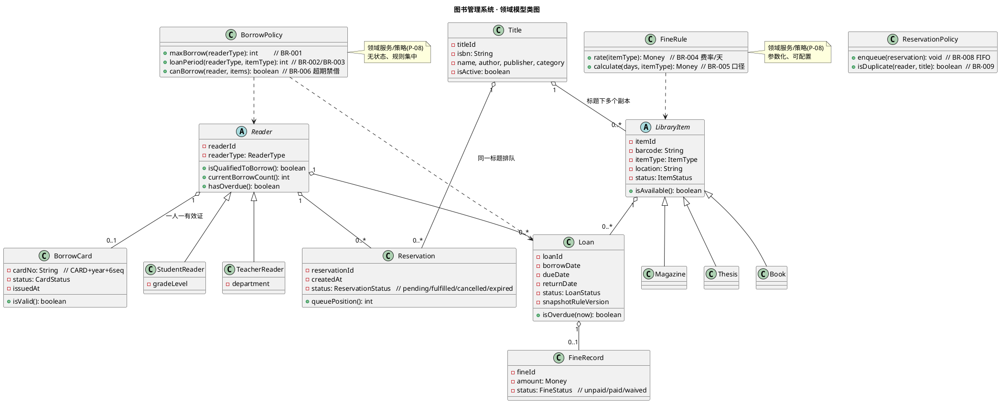

# 05 · 领域模型（Domain Model）

> 本文档依据 `02-requirements.md` 与 `03-use-cases.md` 编制，定义图书管理系统的核心领域类、分类/继承关系、职责与约束。受 `constitution.md` 约束（P-05 分层、P-08 规则集中、P-03 UML 文本化、P-02 起草待审）。
> 命名与 `02`/`03` 中用例、规则编号（BR-xxx）、实体（F-xx）保持一致。

| 项 | 内容 |
|---|---|
| 文档编号 | `specs/05-domain-model.md` |
| 文档类型 | 领域模型（UML 类图 + 类辞典） |
| 版本 | v1.0（草案） |
| 状态 | ☐ Agent 起草 — 待人工审查（P-02） |
| 上游文档 | `00-project-brief.md`、`02-requirements.md`、`03-use-cases.md`、`constitution.md` |

---

## 1. 类图（UML · PlantUML 文本源）

> UML 文本源内嵌于本文件，符合 `constitution.md` P-03。集中存放于 `specs/diagrams/domain-model.puml` 可在后续步骤生成。

---

## 2. 分类原则：实体 / 值对象 / 服务（策略）

| 分类 | 含义 | 本模型成员 |
|---|---|---|
| **实体 Entity** | 有唯一标识、有生命周期、可变化 | Reader（及子类）、BorrowCard、Title、LibraryItem（及子类）、Loan、Reservation、FineRecord、Account |
| **值对象 Value Object** | 无标识、按值相等、不可变 | Money（金额）、ItemType（借出物类型枚举）、ReaderType（读者类型枚举）、CardStatus / LoanStatus / ReservationStatus / FineStatus（状态枚举）、DateRange（期限区间） |
| **领域服务 / 策略 Service / Policy** | 无状态、封装业务规则、跨实体协作 | **BorrowPolicy**、**FineRule**、ReservationPolicy、CardPolicy（证号生成 F-09） |

### 2.1 为什么 BorrowPolicy 与 FineRule 是"策略/服务"而非实体
- 它们**不持有业务数据、无唯一标识、不可变**（P-08 业务规则集中原则）。
- 它们是规则的**载体与执行点**：BorrowPolicy 集中实现 BR-001（数量上限）、BR-002/BR-003（期限）、BR-006（超期禁借）；FineRule 集中实现 BR-004（费率）、BR-005（超期天数口径）。
- 规则参数来自可配置的规则表（`02` FR-016 / BR 载体），策略对象只**读取参数并计算**，不存储状态——因此它们是**无状态领域服务 / 策略**，而非实体。
- 领域实体（Reader / Loan / LibraryItem）只提供数据，规则判断委托给策略，避免规则散落在 Controller 或路由（呼应 P-06、消解 `00` 差距 G-04/G-05）。

---

## 3. 核心领域类辞典

### 3.1 Reader（读者 · 抽象实体）
- **职责**：表示持借阅证可借书的主体；提供借阅资格判断。
- **关键属性**：`readerId`、`readerType: ReaderType`、`accountId`（关联登录账号）。
- **关键方法/行为**：`currentBorrowCount()`（统计在借数，BR-001 口径）、`hasOverdue(now)`（是否存在超期未还，BR-006）、`isQualifiedToBorrow()`。
- **约束**：同一读者至多一个有效借阅证（BR-012）；读者类型枚举见 `02` BR-001/BR-002。
- **关系**：1 对 1 关联 BorrowCard；1 对多 Loan、Reservation；1 对 1 Account。

### 3.2 StudentReader（学生读者 · 实体，继承 Reader）
- **职责**：本科生/硕士/博士/专科的读者子类，承载细分类型信息。
- **关键属性**：`gradeLevel`（本科/硕士/博士/专科）。
- **关键方法**：继承 Reader；类型对应的上限/期限由 BorrowPolicy 依据 `readerType` 取 BR-001/BR-002（专科生上限/期限 TBD(D-01)）。
- **约束**：建模方式待确认（Q-01/D-09），倾向"类型字段 + 规则表"而非深层继承链。
- **关系**：泛化自 Reader。

### 3.3 TeacherReader（教师读者 · 实体，继承 Reader）
- **职责**：教师读者子类，上限 20、期限 90 天（BR-001/BR-002）。
- **关键属性**：`department`。
- **关系**：泛化自 Reader。

### 3.4 BorrowCard（借阅证 · 实体）
- **职责**：读者的借阅凭证，记录证号、状态、有效期，绑定读者类型。
- **关键属性**：`cardNo: String`（F-09 格式 `CARD+year+6seq`）、`status: CardStatus`、`issuedAt`、`readerId`。
- **关键方法**：`isValid()`（状态=有效且读者存在）。
- **约束**：一人一有效证（BR-012）；证号系统生成不可重复（BR-011）。
- **关系**：1 对 1 从属于 Reader（组合，Reader 控制生命周期）。

### 3.5 Title（图书标题/作品 · 实体）
- **职责**：作品层信息（题名），一个标题下挂多个物理副本。
- **关键属性**：`titleId`、`isbn`（唯一）、`name`、`author`、`publisher`、`category`、`publishedYear`、`isActive`。
- **关键方法**：`activeCopies()`（统计在馆副本）、`softDelete()`（FR-007，无在借副本时）。
- **约束**：ISBN 唯一；软删除（FR-007）。
- **关系**：1 对多 LibraryItem（组合）；1 对多 Reservation（预约按标题排队）。

### 3.6 LibraryItem（馆藏副本 · 抽象实体）
- **职责**：某一标题下的具体可借物理副本，具有唯一条码与状态；借阅作用在副本上。
- **关键属性**：`itemId`、`barcode`（唯一）、`itemType: ItemType`、`location`、`status: ItemStatus`（在馆/借出/报废）。
- **关键方法**：`isAvailable()`（状态=在馆）。
- **约束**：条码唯一（FR-008）；在借中不可删除（FR-009）。
- **关系**：泛化出 Book / Magazine / Thesis；1 对多 Loan（同一副本不同时间多次借出）；组合自 Title。

### 3.7 Book（图书 · 实体，继承 LibraryItem）
- **职责**：图书类副本，区分中文/外文（IT-01/IT-02），费率 0.1/0.2 元/天（BR-004）。
- **关键属性**：可附加 `language`（中文/外文）。
- **关系**：泛化自 LibraryItem。

### 3.8 Magazine（杂志 · 实体，继承 LibraryItem）
- **职责**：杂志类副本，区分中文/外文（IT-03/IT-04），费率 0.1/0.2 元/天（BR-004）。
- **关系**：泛化自 LibraryItem。

### 3.9 Thesis（论文 · 实体，继承 LibraryItem）
- **职责**：论文副本（IT-05），费率 0.5 元/天（BR-004）；可外借性 TBD(D-06)，临时可外借。
- **关系**：泛化自 LibraryItem。

> 注：`02`/`03` 中"借出物类型"维度（IT-01~IT-05）由 `ItemType` 值对象承载；中/外文细分可作为 Book/Magazine 的属性或进一步子类（本期不强制），不影响继承主干。

### 3.10 Loan（借阅记录 · 实体）
- **职责**：一次借阅行为记录，含借出/应还/实还、状态、规则快照。
- **关键属性**：`loanId`、`borrowDate`、`dueDate`、`returnDate`、`status: LoanStatus`（borrowing/returned/overdue）、`snapshotRuleVersion`（BR-015/16 快照）。
- **关键方法**：`isOverdue(now)`（returnDate>dueDate 或 在借且 now>dueDate）。
- **约束**：创建时由 BorrowPolicy 计算 `dueDate`（BR-002/003）；快照规则版本，历史不受后续规则变更影响（BR-015）。
- **关系**：组合自 Reader（1 对多）；组合自 LibraryItem（1 对多）；1 对 0..1 FineRecord。

### 3.11 Reservation（预约 · 实体）
- **职责**：读者对某标题的预约请求，进入 FIFO 队列。
- **关键属性**：`reservationId`、`createdAt`、`status: ReservationStatus`（pending/fulfilled/cancelled/expired, D-05）。
- **关键方法**：`queuePosition()`（按 `createdAt` 升序，BR-008）。
- **约束**：同一读者对同一标题不能有多个有效（pending）预约（BR-009）；保留期 TBD(D-05)。
- **关系**：组合自 Reader（1 对多）；组合自 Title（1 对多，标题级排队）。

### 3.12 FineRecord（罚款记录 · 实体）
- **职责**：因超期归还产生的罚款记录，记录金额与缴纳状态（不接支付，OOS-01）。
- **关键属性**：`fineId`、`amount: Money`、`status: FineStatus`（unpaid/paid/waived）。
- **关键方法**：`waive()`、`markPaid()`（仅记录状态，不触发真实扣款）。
- **约束**：金额由 FineRule 计算（BR-004/005）；封顶 TBD(D-03)。
- **关系**：组合自 Loan（1 对 0..1）。

### 3.13 BorrowPolicy（借阅策略 · 领域服务/策略，无状态）
- **职责**：集中实现借阅数量、期限、超期禁借规则（P-08）。
- **关键方法**：
  - `maxBorrow(readerType): int` —— 返回该类型上限（BR-001：本科5/硕士10/博士15/教师20/专科TBD）。
  - `loanPeriod(readerType, itemType): int` —— 返回期限天数（BR-002/BR-003；借出物类型维度 TBD(D-02)）。
  - `canBorrow(reader, activeLoans): boolean` —— 校验上限与超期（BR-001/BR-006）。
- **约束**：规则参数来自规则表，不得硬编码；新增类型不改判断逻辑（P-08）。
- **关系**：依赖 Reader、Loan 数据；被借书用例（UC-03）调用。

### 3.14 FineRule（罚款规则 · 领域服务/策略，无状态）
- **职责**：集中实现各借出物类型的超期罚款费率与计算口径（P-08）。
- **关键方法**：
  - `rate(itemType): Money` —— 返回日费率（BR-004：中文图书0.1/外文图书0.2/中文杂志0.1/外文杂志0.2/论文0.5 元/天）。
  - `calculate(overdueDays, itemType): Money` —— 按自然日、向上取整（BR-005）计算金额；封顶 TBD(D-03)。
- **约束**：费率参数化、可配置（FR-016）；与 BorrowPolicy 同属规则集中点。
- **关系**：被还书用例（UC-04 include UC-10）调用；依赖 LibraryItem 的 `itemType`。

### 3.15（可选）ReservationPolicy / CardPolicy
- **ReservationPolicy**：封装预约 FIFO 入队（BR-008）与去重（BR-009）。
- **CardPolicy**：封装证号生成 `CARD+year+6seq`（BR-011）与"一人一证"校验（BR-012）。均属无状态策略。

### 3.16 Account（系统账号 · 实体，支撑）
- **职责**：登录账号与角色（reader / librarian / admin），与 Reader 一对一并区分操作人（F-01/F-03）。
- **关键属性**：`accountId`、`username`（唯一）、`role`、`readerId?`。
- **约束**：角色决定接口权限（BR-014 / P-07）；口令存储 G-07（计划哈希）。
- **关系**：1 对 1 Reader；librarian/admin 账号不持借阅证。

---

## 4. 关系总览（ER 摘要）

| 关系 | 基数 | 约束来源 |
|---|---|---|
| Reader ◄-- BorrowCard | 1 : 0..1（至多一有效证） | BR-012 |
| Reader ◄-- Loan | 1 : 0..* | BR-001 口径 |
| Reader ◄-- Reservation | 1 : 0..* | BR-009 |
| Title ◄-- LibraryItem | 1 : 0..* | 两级模型（G-03） |
| LibraryItem ◄-- Loan | 1 : 0..* | 副本可多次借出 |
| Loan ◄-- FineRecord | 1 : 0..1 | BR-004 |
| Title ◄-- Reservation | 1 : 0..* | 标题级排队（BR-008） |
| Account ◄-- Reader | 1 : 1 | F-01/F-03 |

---

## 5. 与架构分层映射（P-05）

| 层 | 落地的类 |
|---|---|
| 领域层 Domain | 本节全部实体、值对象、策略（BorrowPolicy/FineRule/ReservationPolicy/CardPolicy） |
| 应用服务层 Application | 用例编排服务（借书服务、还书服务、预约服务等），调用领域策略 |
| 表现层 Presentation | Controller 仅做参数校验 + 调用应用服务 + 组装 `{code,message,data}` |
| 基础设施层 Infrastructure | ORM 模型映射（Reader/Title/LibraryItem/Loan/Reservation/FineRecord/Account 的持久化），实现仓储接口 |

> 领域层不得 import FastAPI / SQLAlchemy（P-05）；业务规则全部经由 BorrowPolicy / FineRule，不在 Controller 或路由中实现（P-06、P-08）。

---

## 6. 待确认项对齐

| 编号 | 影响类 | 处理 |
|---|---|---|
| D-01 | Reader/BorrowPolicy（专科生数值） | 暂按本科同档，标注 TBD |
| D-02 | BorrowPolicy.loanPeriod（借出物类型维度） | 缺省取读者类型值，标注 TBD |
| D-03 | FineRule（封顶/免罚期） | 暂不封顶、0 免罚期，标注 TBD |
| D-05 | Reservation（状态机/保留期） | 定义状态集合，保留期待定 |
| D-06 | Thesis（可外借性） | 临时可外借，标注 TBD |
| D-09 | Reader 建模方式 | 倾向类型字段+规则表，待确认 |

---

## 7. 审查与变更

| 版本 | 日期 | 变更摘要 | 审查状态 |
|---|---|---|---|
| v1.0（草案） | 2026-10-17 | 首次生成：16 个领域类（含继承体系）、实体/值对象/策略分类、PlantUML 类图、分层映射 | ☐ 待人工审查 |
