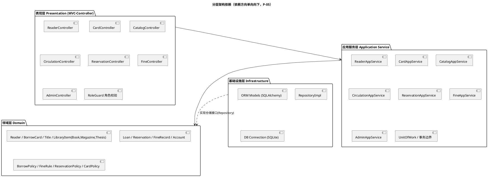
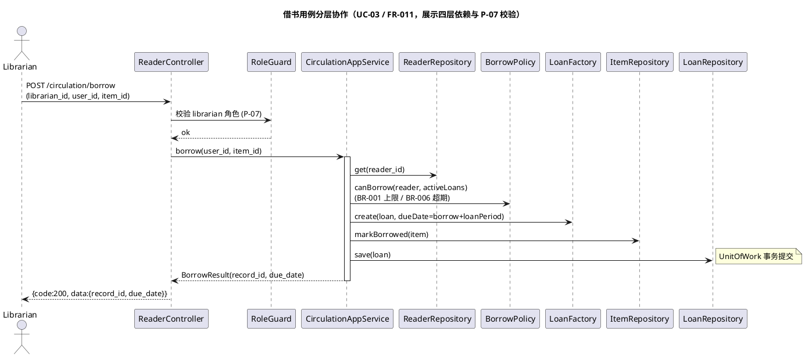

# 07 · 架构设计说明书（Architecture Design）

> 本文档依据 `00-project-brief.md`、`02-requirements.md`、`05-domain-model.md`、`constitution.md` 编制，定义系统的分层架构、MVC 落地、模块划分、权限、异常、事务与业务规则归属。
> 受 `constitution.md` 约束：分层 P-05、MVC P-06、权限 P-07、规则集中 P-08、UML 文本化 P-03、起草待审 P-02。命名与 `02`（FR-/BR-）、`05`（领域类）、`01`（F-/D-）保持一致。

| 项 | 内容 |
|---|---|
| 文档编号 | `specs/07-architecture.md` |
| 文档类型 | 软件架构设计（C4/分层 + UML 包图/顺序图） |
| 版本 | v1.0（草案） |
| 生成方式 | Agent 起草（模型：AI 编码助手） |
| 审查状态 | ☐ 待人工审查（依据 P-02） |
| 上游文档 | `00-project-brief.md`、`02-requirements.md`、`05-domain-model.md`、`constitution.md` |
| 约束引用 | P-03 / P-05 / P-06 / P-07 / P-08 / P-09 |

---

## 1. 架构总览

系统采用**四层分层架构 + MVC 模式**，依赖方向**严格单向向下**：

```
表现层(Presentation / MVC-Controller)
        │ 依赖
        ▼
应用服务层(Application Service)
        │ 依赖
        ▼
领域层(Domain)  ◄────────── 基础设施层(Infrastructure) 实现其仓储接口
```

- 表现层只认识应用服务层提供的契约（DTO + 方法），不直达领域或数据库。
- 应用服务层编排领域对象与仓储，是**事务边界**所在（§7）。
- 领域层是业务核心，纯 Python、无框架依赖（P-05 验收：领域层无 FastAPI/SQLAlchemy import）。
- 基础设施层**依赖**领域层（实现领域层定义的仓储接口），不反向被领域层依赖（P-05）。

### 1.1 包图 / 组件图（P-03 要求）



---

## 2. 四层职责详解（P-05）

### 2.1 表现层（Presentation · MVC 的 Controller/View）

| 维度 | 内容 |
|---|---|
| **职责** | 接收 HTTP 请求（FastAPI 路由）；参数绑定与基础格式校验；调用**唯一**一个应用服务方法；将结果映射为统一响应 `{code, message, data}`（P-06、§6）；集中执行**轻量角色校验**（P-07、§5）。 |
| **允许包含** | 请求/响应 DTO 装配、`RoleGuard` 角色校验、参数非空/类型/范围校验（如 `page<1` 返回 400）、异常到 code 的映射（§6）、REST 端点定义。 |
| **禁止包含** | 任何业务规则（`if 超期`/`if 超额`/`计算罚款`）；SQL 或 ORM 会话；直接访问数据库；绕过统一响应返回裸 dict/对象。 |
| **MVC 角色** | Controller = 薄控制器；Model = 领域层 + 应用层；View = 统一 JSON 响应（本项目无独立前端，View 形态为 REST API + Agent 对话，Q-27 默认）。 |

### 2.2 应用服务层（Application Service）

| 维度 | 内容 |
|---|---|
| **职责** | 用例编排（一个服务方法 = 一个用例，如借书 UC-03）；调用领域对象与 `Policy` 做业务判断；通过仓储读写聚合；**开启并提交/回滚事务**（§7）；组装返回 DTO。 |
| **允许包含** | 用例流程控制、事务边界（UnitOfWork）、跨聚合协调、DTO↔领域对象转换、调用 `BorrowPolicy`/`FineRule`/`ReservationPolicy`/`CardPolicy`。 |
| **禁止包含** | HTTP 细节（Request/Response 对象）；SQL/ORM 查询（交由仓储）；业务规则本身的算法（仅"调用"策略，不"实现"规则）。 |
| **与领域层关系** | 依赖领域层类型与仓储接口；是"编排者"而非"规则所有者"。 |

### 2.3 领域层（Domain）

| 维度 | 内容 |
|---|---|
| **职责** | 承载实体（`Reader`、子类、`BorrowCard`、`Title`、`LibraryItem` 及子类、`Loan`、`Reservation`、`FineRecord`、`Account`）、值对象（`Money`、`ItemType`、`ReaderType`、各状态枚举、`DateRange`）、**领域服务/策略（Policy）**（P-08、§8）。提供状态流转与不变约束。 |
| **允许包含** | 实体行为方法（`Loan.isOverdue()`、`BorrowCard.isValid()`）、无状态 `Policy` 类（`BorrowPolicy.maxBorrow/loanPeriod/canBorrow`、`FineRule.rate/calculate`、`ReservationPolicy.enqueue/isDuplicate`、`CardPolicy`）、领域异常定义。 |
| **禁止包含** | `import fastapi` / `import sqlalchemy` 等任何框架依赖；数据库访问（由仓储接口抽象）；HTTP/JSON 解析；IO 副作用。 |
| **分类依据** | 同 `05` §2：实体（有标识、有生命周期）、值对象（按值相等、不可变）、策略（无状态、封装规则）。 |

### 2.4 基础设施层（Infrastructure / Persistence）

| 维度 | 内容 |
|---|---|
| **职责** | 实现领域层定义的**仓储接口**（Repository）；ORM 模型映射（SQLAlchemy）到 SQLite；数据库连接与会话管理；外部适配（本期无真实支付/条码硬件，OOS-01/OOS-02）。 |
| **允许包含** | SQLAlchemy `Base` 子类、Repository 实现、`engine`/`Session` 工厂、种子数据、数据库迁移脚本。 |
| **禁止包含** | 业务规则判断（`if 超期`、配额比较）；权限校验；业务计算。仓储只做"存/取/查"，不"判"。 |
| **依赖方向** | `I --> D`：基础设施依赖领域（实现其接口），领域**不**依赖基础设施（P-05）。 |

---

## 3. 业务模块划分（P-05 / §4 要求）

系统按业务能力划分为 7 个模块，每个模块跨层落地如下（模块名即 `backend/app/` 下的子包，体现分层，见 §10）：

| 模块 | 核心用例 / FR | 领域对象 | 应用服务 | 表现层 Controller | 关键 Policy |
|---|---|---|---|---|---|
| **reader（读者）** | UC-01 注册（FR-001） | `Reader`/`StudentReader`/`TeacherReader`、`Account` | `ReaderAppService` | `ReaderController` | — |
| **card（借阅证）** | UC-02 办证/注销（FR-002/003） | `BorrowCard` | `CardAppService` | `CardController` | `CardPolicy`（证号 F-09、一人一证 F-10） |
| **catalog（馆藏图书）** | UC-07/08 标题与副本维护（FR-006~009） | `Title`、`LibraryItem`/`Book`/`Magazine`/`Thesis` | `CatalogAppService` | `CatalogController` | — |
| **circulation（流通借还）** | UC-03 借书、UC-04 还书（FR-011/012） | `Loan`、`LibraryItem`、`Reader` | `CirculationAppService` | `CirculationController` | `BorrowPolicy`（BR-001/002/006）、`FineRule`（还书触发） |
| **reservation（预约）** | UC-06 预约/取消（FR-014/017） | `Reservation`、`Title` | `ReservationAppService` | `ReservationController` | `ReservationPolicy`（BR-008 FIFO、BR-009 去重） |
| **fine（罚款）** | UC-10 罚款计算/查询（FR-015/018） | `FineRecord`、`Loan` | `FineAppService` | `FineController` | `FineRule`（BR-004/005） |
| **admin（后台管理）** | 增删管理员、维护规则（FR-004/005/016） | `Account`、规则表 | `AdminAppService` | `AdminController` | `BorrowPolicy`/`FineRule`/`ReservationPolicy` 参数维护入口 |

> 说明：模块内"流通"与"罚款"共享 `FineRule`（还书即触发罚款，FR-012 include FR-015）；"后台管理"不持有独立业务对象，而是对其他模块的可写入口（遵循 F-03 权限矩阵）。

---

## 4. 权限控制策略（P-07，结合 constitution §1 F-01~F-03）

### 4.1 权限矩阵（强制）

| 能力 | 读者 | 图书管理员 | 系统管理员 |
|---|---|---|---|
| 注册账号 | ✔ | — | — |
| 检索图书 | ✔ | ✔ | ✔ |
| 查询本人借阅信息 | ✔ | ✔（代查） | ✔ |
| **办理借书 / 还书** | ✘ | **✔（唯一执行者，F-02）** | ✘ |
| 预约 / 取消预约 | ✔ | ✔（代办） | ✔ |
| 办理/删除借阅证 | ✘ | ✘ | **✔（F-03）** |
| 维护标题 / 馆藏副本 | ✘ | ✘ | **✔** |
| 增删管理员、维护规则 | ✘ | ✘ | **✔** |

### 4.2 实现策略（轻量角色校验，非真实认证）

- 第一阶段按 **F-01 不做真实登录认证**，操作人由 `user_id` / `librarian_id` / `admin_id` 参数显式传入。
- **但必须实现轻量角色校验**（P-07）：`librarian_id` 对应 `Account.role == 'librarian'`；`admin_id` 对应 `role == 'admin'`；读者接口校验 `user_id` 存在且 `role == 'reader'`。
- **校验集中在一处**：表现层统一 `RoleGuard` 依赖（或应用层前置校验），**不在每个接口各写一遍**（P-07 禁止"只要传了 ID 就通过"）。
- 读者尝试借书（`FR-011` 以 `user_id` 而非 `librarian_id` 调用）必须**明确返回 400**，不得静默成功或降级为预约。
- 权限判断**不得写入 SQL 或仓储**（P-07 禁止），仅位于 `RoleGuard` / 应用服务前置。
- **必须有测试覆盖**（`pytest` 断言"读者借书被拒""管理员越权访问后台接口被拒"，P-07 / P-09）。

---

## 5. 异常处理与统一响应策略（P-06）

所有穿越 API 边界的响应遵循基线统一结构（与 `00` §9 一致，不得另造错误码体系）：

```json
{ "code": 200, "message": "ok", "data": { ... } }
```

| code | 含义 | 触发场景 |
|---|---|---|
| `200` | 成功 | 业务正常完成 |
| `400` | 业务错误 | 超额/超期/重复/参数非法/权限不足/无可用副本 |
| `404` | 资源不存在 | 读者、标题、副本、记录不存在 |
| `500` | 系统错误 | 未预期的异常（不应泄露栈信息） |

- 表现层提供**全局异常处理器**：将领域/应用抛出的语义异常映射为上述 `code` + 中文 `message`，`data` 可为 null 或明细。
- 语义异常建议（领域层定义，基础设施不判规则）：`PolicyViolationException`（超额/超期/重复预约）、`PermissionDeniedException`（P-07）、`NotFoundException`、`ConflictException`（已在借副本删除等）。
- **禁止**：在 Controller 直接 `return {"ok": True}` 裸字典；返回框架默认 HTML 错误页；把堆栈或 SQL 错误透传给客户端。

---

## 6. 事务边界（P-05 / §7 要求）

- **事务边界位于应用服务层**：每个用例方法（`*AppService` 的一个 public 方法）是一个事务单元，由 `UnitOfWork` 开启，成功提交、异常回滚。
- 领域层方法**无事务概念**（纯内存逻辑）；基础设施层 Repository 在事务上下文内执行 SQL。
- 跨聚合写（如借书同时改 `Loan` + `LibraryItem.status` + 校验 `Reader` 配额）必须保证原子性：要么全成、要么全回滚。
- 只读查询（检索、查询借阅信息）可不开启写事务，但仍经应用服务层，保持层间一致。

---

## 7. 业务规则归属（P-08，领域层 Policy）

业务规则**全部位于领域层的 Policy / 领域服务**，禁止硬编码散落（反例：基线 `routes.py` 的 `timedelta(days=30)` 与 `0.5 元/天`，对应差距 G-04/G-05，实现时必须消解）。

| 规则（BR / F） | 承载 Policy | 方法 | 参数化来源 |
|---|---|---|---|
| BR-001 数量上限（F-04） | `BorrowPolicy` | `maxBorrow(readerType): int` | 规则表（FR-016） |
| BR-002/003 期限（F-05） | `BorrowPolicy` | `loanPeriod(readerType, itemType): int` | 规则表（D-02 维度 TBD） |
| BR-006 超期禁借（F-07） | `BorrowPolicy` | `canBorrow(reader, activeLoans): bool` | 计算派生 |
| BR-004 费率（F-06） | `FineRule` | `rate(itemType): Money` | 规则表 |
| BR-005 超期天数口径 | `FineRule` | `calculate(overdueDays, itemType): Money` | 规则表（D-03 封顶 TBD） |
| BR-008 FIFO / BR-009 去重（F-08） | `ReservationPolicy` | `enqueue` / `isDuplicate` | 计算派生 |
| BR-011 证号 / BR-012 一人一证（F-09/F-10） | `CardPolicy` | 证号生成 / 有效性校验 | 规则表/约束 |

- **禁止**代码中出现 `if reader_type == 'undergraduate'` 之类的类型分支链（P-08），应走策略/查表。
- 每条规则在 `04-business-rules.md` 有唯一编号，代码注释回引 `BR-xxx`。
- `Loan` 借书时**快照规则版本**（`snapshotRuleVersion`，BR-015），历史记录不受后续规则变更影响。

---

## 8. 设计模式（§9 要求）

| 模式 | 在本架构的落点 | 作用 |
|---|---|---|
| **Strategy（策略）** | `BorrowPolicy` / `FineRule` / `ReservationPolicy` / `CardPolicy`（领域层无状态类） | 借阅、罚款、预约、证号规则可独立演化、参数化配置，消除魔法数字与分支链（P-08）。 |
| **Factory（工厂）** | `ReaderFactory`（按 `readerType` 构造 `StudentReader`/`TeacherReader`）、`CardPolicy.genCardNo()`、`LoanFactory` | 封装对象构造细节与证号生成规则（F-09），客户端不关心子类差异（D-09 倾向类型字段+规则表时，工厂退化为属性装配）。 |
| **Repository（仓储）** | 领域层定义接口（`ReaderRepository`/`LoanRepository`/`TitleRepository`…），基础设施层实现 | 隔离持久化；应用层只依赖接口；领域层零 ORM 依赖（P-05）。 |
| **DTO（数据传输对象）** | 请求/响应对象（`BorrowRequest`、`BorrowResult` 等），位于表现层或应用边界 | 解耦 HTTP 字段与领域对象；统一 `{code,message,data}` 的 `data` 载荷。 |
| **MVC** | Controller（薄，表现层）= 请求分发；Model（领域+应用）= 数据与行为；View = 统一 JSON / Agent 对话 | 满足 P-06：Controller 无业务规则，仅"校验→调用→组装"。 |
| **Unit of Work（事务）** | 应用服务层事务边界 | 保证用例级原子提交/回滚（§7）。 |
| **Dependency Injection** | 表现层注入应用服务、应用层注入仓储/Policy | 维持单向依赖，便于测试替身（mock Repository/Policy）。 |

---

## 9. 分层协作顺序图（P-03：借书用例 UC-03 / FR-011）



> 其他顺序图（还书含罚款、预约 FIFO、超期判定）按 P-03 集中存放于 `specs/diagrams/`，与本文同名图交叉引用，命名须与 `02`/`05`/`06-database-design.md`/`07-api-spec.md` 一致。

---

## 10. 建议目录结构（体现四层，P-05 验收）

```
backend/app/
├── presentation/        # 表现层 (MVC Controller + RoleGuard + DTO + 统一响应)
│   ├── controllers/     # reader/card/catalog/circulation/reservation/fine/admin
│   ├── dtos.py
│   └── response.py      # {code,message,data} 装配 + 全局异常处理
├── application/         # 应用服务层 (用例编排 + 事务边界)
│   └── services/        # *AppService, UnitOfWork
├── domain/              # 领域层 (纯 Python, 无框架依赖)
│   ├── entities.py      # Reader/Title/LibraryItem/Loan/Reservation/FineRecord/Account
│   ├── value_objects.py # Money/ItemType/ReaderType/状态枚举
│   ├── policies.py      # BorrowPolicy/FineRule/ReservationPolicy/CardPolicy
│   └── repositories.py  # 仓储接口(抽象)
└── infrastructure/      # 基础设施层 (实现领域层接口)
    ├── orm_models.py    # SQLAlchemy Base 子类
    └── repository_impl.py
```

---

## 11. 与基线差距对齐（G-/F-/D-）

- 消解 `00` §9 差距 **G-08**（逻辑集中路由层）：逻辑上移领域层与 Policy，路由层变薄（P-05/P-06）。
- 消解 **G-04/G-05**（期限/罚款硬编码）：由 `BorrowPolicy`/`FineRule` 参数化接管（P-08）。
- 未决项按 `constitution.md` §1 处置，代码中显式标注 `TBD(D-xx)`：D-01 专科生数值、D-02 借出物类型期限维度、D-03 罚款封顶/免罚、D-05 预约保留期、D-06 论文可外借、D-09 读者类型建模方式。

---

## 12. 待人类确认要点清单（P-02）

1. **模块粒度**：§3 的 7 模块划分是否符合教师对"实验二"的模块期望（是否需进一步细分如 `auth` 模块）？
2. **角色校验落点**：`RoleGuard` 放在表现层（Controller 依赖）还是应用服务前置？本文默认表现层集中校验。
3. **读者类型建模**：D-09 若定稿为"类型字段+规则表"，`ReaderFactory` 是否退化为纯属性装配（不影响分层）？
4. **DTO 归属**：DTO 置于 `presentation/dtos.py` 还是跨层共享包？默认表现层边界。
5. **顺序图范围**：除借书外还需在本文补"还书/预约"顺序图，还是全部下放 `specs/diagrams/`？

---

## 13. 审查与变更

- 本文档由 Agent 起草，状态"待人工审查"，依 P-02 生效前不得作为实现依据。
- 编号规则：章节固定；任何变更须登记 `10-change-requests.md`（P-04）并递增版本号。

| 版本 | 日期 | 变更摘要 | 审查状态 |
|---|---|---|---|
| v1.0（草案） | 2026-10-17 | 首次生成：四层职责表、7 模块、权限策略、统一异常、事务边界、Policy 归属、设计模式、包图+借书顺序图、目录结构 | ☐ 待人工审查 |
