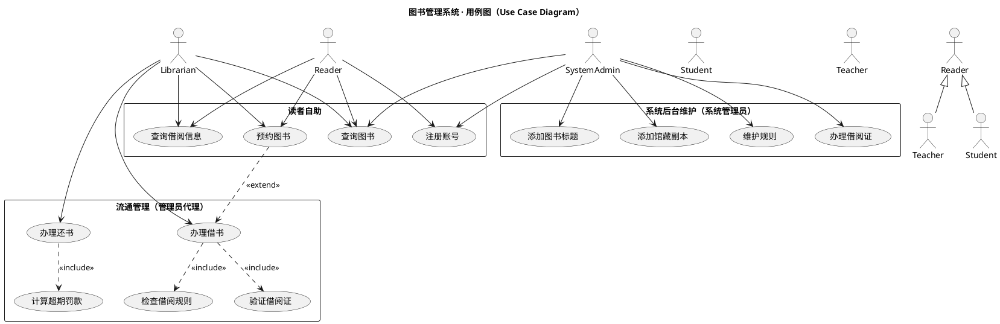
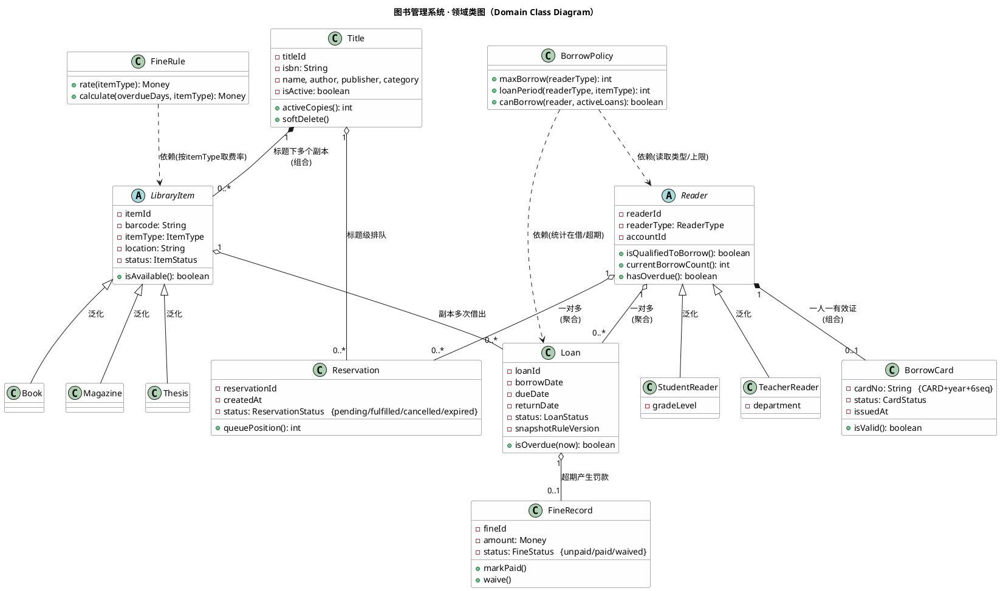

# 软件设计与体系结构 实验一：架构设计与 Spec 建模

**课程**：软件设计与体系结构
**实验项目**：图书管理系统（AI 时代对话式）
**提交人**：__________　**日期**：2026-10-17

---

## 1. 实验目的

本实验以"图书管理系统"为对象，训练在 AI 辅助下的**需求分析、UML 建模、架构设计、数据库设计与规格文档化**能力。具体要求包括：

- 使用 UML（用例图、类图、包图）表达分析与设计结果；
- 采用**分层架构**与 **MVC 模式**组织系统；
- 借助 **Agent（AI 助手）** 辅助生成规格、UML、设计与代码草案；
- 所有 Agent 产出**必须经过人工审查**方可生效；
- 最终须具备可运行代码与自动化测试的潜力（本期聚焦规格与设计）。

通过本实验，掌握"Spec-First（规格优先）"的工程方法，理解如何用约束文档（Charter / Constitution）规范 AI 行为，建立可审查、可追溯、可演进的软件基线。

---

## 2. 项目概述

本项目是一个**AI 时代的对话式图书管理系统**：用户以自然语言提出需求，由 Agent 将其路由到后端 REST API（端口 8001，统一响应 `{code, message, data}`）完成读者注册、借阅证管理、图书借阅、归还、查询、预约、馆藏维护与超期罚款等核心业务。系统支持本科生、研究生、博士生、专科生、教师等差异化借阅规则，以及中文/外文图书、杂志、论文等差异化超期罚款规则。

---

## 3. 需求分析与建模

需求分析产物为 `02-requirements.md`（需求规格）与 `03-use-cases.md`（用例规约），并以 `04-use-case-model.puml` 表达用例图。

### 3.1 核心功能需求（FR，节选）

| 编号 | 功能 | 主参与者 | 关键业务规则 |
|---|---|---|---|
| FR-001 | 注册读者账号 | 读者/系统管理员 | 选读者类型，口令哈希存储 |
| FR-002 | 办理借阅证 | 系统管理员 | 证号 `CARD+year+6seq`（BR-011），一人一证（BR-012） |
| FR-011 | 借阅图书 | 图书管理员（唯一） | 上限（BR-001）、期限（BR-002）、超期禁借（BR-006） |
| FR-012 | 归还图书 | 图书管理员（唯一） | 触发超期罚款计算（BR-004/005） |
| FR-014 | 预约图书 | 读者 | FIFO 排队（BR-008），同标题去重（BR-009） |
| FR-015 | 计算超期罚款 | 系统 | 费率×天数（BR-004），口径自然日向上取整（BR-005） |
| FR-016 | 维护借阅/罚款规则 | 系统管理员 | 规则参数化、未来生效（BR-015） |

### 3.2 核心业务规则（BR，节选）

- **BR-001 借阅数量上限**：本科 5 / 硕士 10 / 博士 15 / 教师 20（专科生 TBD-D01）。
- **BR-002 借阅期限**：本科 30 / 硕士 60 / 博士 90 / 教师 90 天。
- **BR-004 罚款费率（元/天）**：中文图书 0.1、外文图书 0.2、中文杂志 0.1、外文杂志 0.2、论文 0.5。
- **BR-006 超期禁借**：存在超期未还记录时拒绝新借书。
- **BR-008/009 预约**：多人 FIFO 排队；同读者同标题不重复有效预约。
- **BR-014 权限矩阵**：借还仅图书管理员；办证/维护仅系统管理员。

### 3.3 用例图（04-use-case-model.puml）



---

## 4. 领域建模

领域模型产物为 `05-domain-model.md` 与 `06-domain-class-diagram.puml`，将系统核心抽象为**实体、值对象、领域服务（策略）**三类。

### 4.1 核心实体与策略

- **读者体系**：`Reader`（抽象）泛化为 `StudentReader` / `TeacherReader`；与 `BorrowCard`（一人一有效证）、`Loan`、`Reservation` 为一对多关系。
- **馆藏体系**：`Title`（作品层）组合多个 `LibraryItem`（副本）；`LibraryItem` 泛化为 `Book` / `Magazine` / `Thesis`。
- **记录体系**：`Loan`（借阅记录，含规则快照）、`Reservation`（预约，FIFO）、`FineRecord`（罚款记录）。
- **策略类（无状态，规则集中）**：`BorrowPolicy`（上限/期限/超期禁借）、`FineRule`（费率/计算）、`ReservationPolicy`、`CardPolicy`。

### 4.2 领域类图（06-domain-class-diagram.puml）



---

## 5. 架构设计

架构设计产物为 `07-architecture.md` 与 `08-package-diagram.puml`，遵循 `constitution.md` 的 **P-05（分层）**、**P-06（MVC）**、**P-07（权限）**、**P-08（规则集中）**。

### 5.1 四层架构（依赖单向向下）

| 层 | 职责 | 禁止包含 |
|---|---|---|
| **表现层 Presentation（MVC Controller）** | 接收请求、参数校验、组装 `{code,message,data}`、集中角色校验 | 业务规则、SQL、直连数据库 |
| **应用服务层 Application** | 用例编排、事务边界、调用领域与仓储 | HTTP 细节、SQL |
| **领域层 Domain** | 实体、值对象、**Policy（借阅/罚款/预约规则）** | 框架依赖、数据库访问 |
| **基础设施层 Infrastructure** | ORM 模型、仓储实现、DB 连接 | 业务规则 |

依赖方向：**presentation → application → domain ← infrastructure**（基础设施实现领域层定义的仓储接口）。

### 5.2 业务模块

系统划分为 7 个模块，分别对应应用服务子包：
`reader`（读者）、`card`（借阅证）、`catalog`（馆藏图书）、`circulation`（流通借还）、`reservation`（预约）、`fine`（罚款）、`admin`（后台管理）。

### 5.3 MVC 与关键约束

- **MVC**：Controller 薄（仅"校验→调用→组装"），Model 由领域层+应用层承载，View 为统一 JSON 响应（REST API + Agent 对话）。
- **权限（P-07）**：轻量角色校验集中于 `RoleGuard`；借还仅 `librarian` 可执行，读者调用借书明确返回 400。
- **事务边界**：位于应用服务层（每用例=一事务，UnitOfWork 提交/回滚）。
- **规则集中（P-08）**：`BorrowPolicy`/`FineRule` 等策略类承载全部规则，参数化存储，禁止硬编码。

### 5.4 包图（08-package-diagram.puml）

```plantuml
@startuml
title 分层架构包图（依赖单向向下，P-05 / 07-architecture.md §1）

' ============ 顶层包 ============
package "presentation (表现层)" as pres {
  package "controllers (MVC Controller)" as ctrl {
    [ReaderController]
    [CardController]
    [CatalogController]
    [CirculationController]
    [ReservationController]
    [FineController]
    [AdminController]
  }
  [RoleGuard 角色校验]
}

package "application (应用服务层)" as app {
  package "reader" as a_reader   { [ReaderAppService] }
  package "card" as a_card       { [CardAppService] }
  package "catalog" as a_catalog { [CatalogAppService] }
  package "circulation" as a_circ { [CirculationAppService] }
  package "reservation" as a_res { [ReservationAppService] }
  package "fine" as a_fine       { [FineAppService] }
  package "admin" as a_admin     { [AdminAppService] }
  [UnitOfWork 事务边界]
}

package "domain (领域层)" as dom {
  package "entities (实体)" as ent {
    [Reader / BorrowCard / Title / LibraryItem(Book,Magazine,Thesis)]
    [Loan / Reservation / FineRecord / Account]
  }
  package "domain services (Policy)" as pol {
    [BorrowPolicy]
    [FineRule]
    [ReservationPolicy]
    [CardPolicy]
  }
  package "repository interfaces (仓储接口)" as repoI {
    [ReaderRepository]
    [LoanRepository]
    [TitleRepository]
    [ReservationRepository]
    [FineRepository]
  }
}

package "infrastructure (基础设施层)" as infra {
  package "repository impl (仓储实现)" as repoImpl {
    [ReaderRepositoryImpl]
    [LoanRepositoryImpl]
    [TitleRepositoryImpl]
    [ReservationRepositoryImpl]
    [FineRepositoryImpl]
  }
  package "db config (数据库配置)" as db {
    [ORM Models (SQLAlchemy)]
    [DB Connection (SQLite)]
  }
}

package "dto (数据传输对象)" as dto {
  [Request / Response DTOs]
}

package "test (自动化测试)" as test {
  [pytest + TestClient 测试集]
}

' ============ 依赖方向（单向向下） ============
pres --> app        : 表现层依赖应用层
app  --> dom        : 应用层依赖领域层(含仓储接口)
infra ..|> dom      : 基础设施实现领域层定义的仓储接口
infra ..> dom       : 基础设施依赖领域实体/接口
app  ..> dto        : 应用层装配 DTO
pres ..> dto        : 表现层装配请求/响应 DTO
test ..> app
test ..> dom
test ..> infra

' 严禁：表现层 Controller 不得直接依赖基础设施层的 Repository
' （即不得出现 pres --> infra 或 ctrl --> repoImpl）

@enduml
```

> **关键架构红线**：上图中**不存在** `pres --> infra`（Controller 不得直接依赖 Repository），依赖必须经 `presentation → application → domain ← infrastructure` 单向向下。

---

## 6. 数据库设计

数据库设计产物为 `13-database-design.md`，共定义 **11 张表**，与领域模型严格对应：

| 表名 | 对应领域类 | 关键字段 |
|---|---|---|
| `readers` | Reader（STI） | reader_id(PK)、username、reader_type（判别列）、password_hash |
| `borrow_cards` | BorrowCard | card_no(UNIQUE)、reader_id(FK,UNIQUE 一人一证) |
| `librarians` / `system_admins` | Account（按角色分表） | username、password_hash |
| `book_titles` | Title | isbn(UNIQUE)、is_active（软删除） |
| `library_items` | LibraryItem（STI） | barcode(UNIQUE)、item_type（判别列）、status |
| `loans` | Loan | reader_id/item_id/librarian_id(FK)、due_date、snapshot_rule_version |
| `reservations` | Reservation | reader_id/title_id(FK)、created_at（FIFO）、status |
| `borrow_policies` | BorrowPolicy 载体 | reader_type、max_borrow、loan_period_days、version |
| `fine_rules` | FineRule 载体 | item_type、rate_per_day、cap_amount、version |
| `fine_records` | FineRecord | loan_id(FK,UNIQUE)、amount、status |

**继承映射策略**：`Reader` 子类、`LibraryItem` 子类均采用**单表继承（STI）**，以 `reader_type` / `item_type` 为判别列；规则采用**版本化参数表**，借书时快照 `snapshot_rule_version`，保证历史记录不受后续规则变更影响（BR-015）。索引覆盖检索、去重、超期扫描等关键路径。

---

## 7. AI Agent 协同复盘

本实验的核心方法论是：**用 `constitution.md`（工程宪章）约束 AI，用规格链建立 baseline（基线）**。

### 7.1 如何用 constitution.md 约束 AI

`constitution.md` 是本项目的**最高约束文档**，定义 11 条原则（P-01~P-11）与已确认事实（F-01~F-10）：

- **P-01 Spec-First**：先完成规格链（00~09）再编码，禁止"先跑通再补文档"。
- **P-02 Agent 起草、人类确认**：所有 Agent 产出标注"待审查"，未经人工书面确认不得作为实现依据。
- **P-03 UML-as-Spec**：UML 必须为 PlantUML/Mermaid 文本源，纳入版本管理，与文字规格同等效力。
- **P-05 分层架构**：四层 + 依赖单向向下，领域层无框架依赖。
- **P-06 MVC**：Controller 薄，业务规则不入 Controller。
- **P-07 权限分离**：三类角色权限矩阵，接口层强制校验。
- **P-08 规则集中**：规则进入 Policy，参数化、禁硬编码。
- **P-09 测试闭环**、**P-10 Diff 审查**、**P-11 AI 使用日志**：保障过程留痕与可验证。

Agent 在每次开工前需逐条自检（§14 清单），违反原则的产出视为无效并回滚。

### 7.2 如何建立 baseline（基线）

1. **事实基线**：将澄清问答中的结论固化为 `F-01~F-10`（如免真实认证、借还必须管理员代理、证号格式、各类型上限/费率），Agent 不得与之冲突。
2. **未决项机制**：对 D-01~D-09 未确认项，强制标注 `TBD(D-xx)` 并按临时处置实现，禁止 AI 自选数值。
3. **文档基线**：规格经人工审查后建立 Baseline，实现期变更须登记 `10-change-requests.md`（CR-xx），不得静默改写。
4. **日志基线**：每次 Agent 产出记入 `19-ai-usage-log.md`（本实验 8 条，全部已确认），未记录不纳入基线。

### 7.3 人类的关键纠正（代表性）

最重要的一次纠正是**架构依赖方向**：初版曾隐含"表现层 Controller 直接调用基础设施层 Repository"的隐患。人类依据 P-05/P-06 明确纠正——**Controller 不得直接依赖 Repository**，依赖必须单向向下。该红线被写入 `08-package-diagram.puml` 的禁止注释与 `18-review-checklist.md` 硬性检查项，从根本上消解了基线工程"逻辑集中路由层"（差距 G-08）的问题。

---

## 8. 总结

本实验在 AI 辅助下，完成了从**项目简报 → 需求规格 → 用例/领域/包 UML → 分层架构 → 数据库设计 → 风险与审查**的完整规格链，共产出 13 份规格/设计文档与 3 份 UML 文本源，并配套 AI 使用日志与审查清单。

主要成果与体会：

1. **规格优先（Spec-First）可行且高效**：AI 能高速产出格式统一、编号可追溯的规范文本与 UML，显著缩短前期建模周期。
2. **架构红线必须由人类把关**：分层单向依赖、权限不可绕过、规则不可硬编码等原则，是 AI 易越界而人类必须守住的底线。
3. **约束文档（Charter）是 AI 协同的关键**：`constitution.md` 以"原则 + 事实 + 未决项机制 + 日志"四件套，使 AI 的产出可控、可审、可演进。
4. **可追溯性闭环**：FR→UC→类→表→测试编号逐层可追溯，满足 NFR-03，为后续实验二（详细设计/编码/测试）奠定了清晰、合规的基线。

> 后续工作（实验二及以后）：基于本基线推进 `09-tasks.md` 任务拆解、详细设计、代码实现与 `pytest` 自动化测试，所有变更经 CR 登记，持续记录 AI 使用日志。

---

*（本报告依据 `specs/` 目录下 00~19 文档与 UML 图整理，可直接作为实验一提交材料。）*
